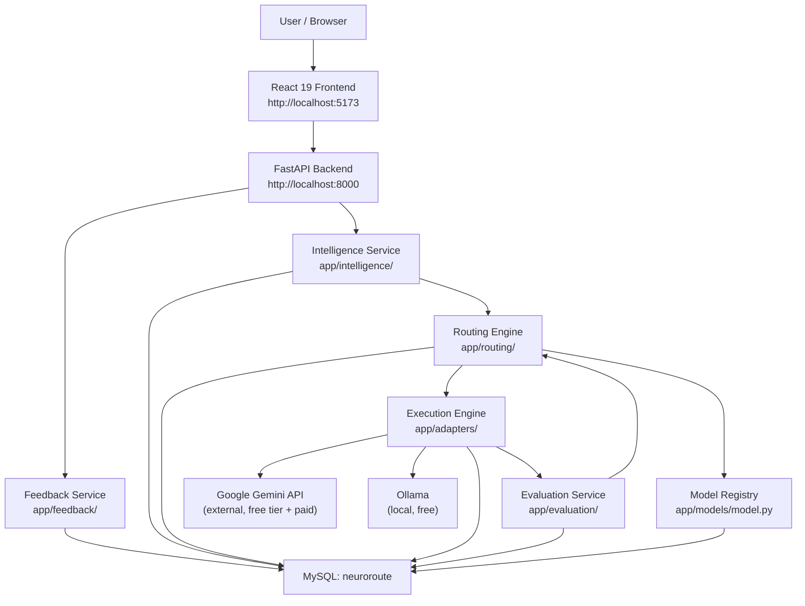

# Design Document

## Overview

NeuroRoute MVP extends the existing React 19 + FastAPI + MySQL application with six new backend subsystems that form an adaptive AI inference pipeline. A single `POST /api/requests/` call now orchestrates the full chain: the Intelligence Service classifies the prompt's complexity, the Routing Engine selects the optimal LLM based on configurable policy, the Execution Engine dispatches the prompt and captures metrics, and the Evaluation Service scores the response and triggers escalation when confidence is low. A Feedback Service collects user ratings, and an Observability Dashboard surfaces routing decisions, execution metrics, and quality scores to the frontend.

All new subsystems are implemented as plain Python modules in `backend/app/`, following the existing SQLAlchemy 2.x / Pydantic v2 / FastAPI conventions. No new databases, caches, or message queues are introduced. External model calls to the Google Gemini API are free within the free tier's limits and billed per token beyond it; Ollama is free for local use.

---

## Architecture

### Component Diagram



### End-to-End Data Flow

```
POST /api/requests/
        │
        ▼
1. Persist Request (status="pending")
        │
        ▼
2. Intelligence Service
   ─ tokenise prompt
   ─ classify → Complexity_Class + explanation
        │
        ▼
3. Routing Engine
   ─ query enabled models from Registry
   ─ apply active Routing_Policy
   ─ persist Routing_Decision
        │
        ▼
4. Execution Engine
   ─ resolve Provider_Adapter
   ─ dispatch prompt to LLM provider
   ─ capture response, tokens, latency, cost
   ─ persist Execution_Record
        │
        ▼
5. Evaluation Service
   ─ score quality + confidence
   ─ persist Evaluation_Record
   ─ check escalation threshold
   ─ if escalate → repeat steps 3-5 (max once)
        │
        ▼
6. Update Request (status="completed", complexity_class, end_to_end_latency_ms)
        │
        ▼
7. Return HTTP 200 with full response object
```

### Degraded Modes

- **Routing Engine unavailable**: Request persisted with `status="pending"`, HTTP 202 returned. No Execution or Evaluation occurs.
- **Intelligence Service unavailable (alone)**: The pipeline continues with the fallback `complexity_class="moderate"` (MEDIUM); an `intelligence` entry is added to `step_errors`; HTTP 200 with `status="partial"`. HTTP 202 is NOT returned.
- **Execution failure (provider error or timeout)**: Execution_Record stored as `failed` or `timed_out`; the error is added to `step_errors`; the pipeline continues.
- **Evaluation Service fails after a completed execution**: The Execution_Record and its response text are preserved; `evaluation` is null; an `evaluation` entry is added to `step_errors`; request status is `partial`; HTTP 200 is returned (never 202, never `pending`).
- **Baseline_Router mode**: `BASELINE_MODEL_ID` env var overrides policy selection; deterministic model choice.

---

## Components and Interfaces

### Intelligence Service (`backend/app/intelligence/`)

**`complexity.py`** — Tokenisation

```python
def tokenise(text: str) -> list[str]:
    """Split text on whitespace and punctuation. Returns a list of tokens."""

def count_tokens(text: str) -> int:
    """Return the number of whitespace-and-punctuation tokens in text."""
```

**`classifier.py`** — Classification logic

```python
from typing import Literal

from app.intelligence.complexity import count_tokens, tokenise

# Stored and returned labels. Tier mapping: simple = LOW (1), moderate = MEDIUM (2), complex = HIGH (3).
ComplexityClass = Literal["simple", "moderate", "complex"]

class ClassificationResult(BaseModel):
    complexity_class: ComplexityClass
    explanation: str  # 10-300 characters

def classify_prompt(prompt: str) -> ClassificationResult:
    """
    Deterministic, rule-based classification (no model call, no randomness, no I/O).

    Measures (case-insensitive, matched against fixed term lists):
      N = token count
      D = number of distinct DOMAIN_KEYWORDS found
      R = number of distinct REASONING_CONNECTIVES found
      S = number of distinct SYNTHESIS_INDICATORS found

    Rules, evaluated in this order (first match wins):
      1. HIGH   / "complex":  R >= 3  OR  S >= 2  OR  D >= 3  OR  N >= 200
      2. LOW    / "simple":   N < 50  AND  D == 0  AND  R < 2  AND  S == 0
      3. MEDIUM / "moderate": every other prompt (fallback for unclassified prompts)

    Raises ValueError if the prompt is empty/whitespace-only or has more than 1000 tokens.
    """
```

**Classification policy** (identical to Requirements 2.3-2.5 and Task 4.2). The three conditions are mutually exclusive and exhaustive: the LOW and HIGH conditions can never both hold, and MEDIUM is the explicit fallback for everything else, including any prompt of 50 to 199 tokens that matches no indicator. When the Intelligence Service itself fails, the pipeline also falls back to MEDIUM (`moderate`).

| Class (tier) | Condition |
|---|---|
| `complex` (HIGH) | R >= 3, or S >= 2, or D >= 3, or N >= 200 |
| `simple` (LOW) | N < 50 and D = 0 and R < 2 and S = 0 |
| `moderate` (MEDIUM) | anything else (fallback) |

Fixed term lists (single words, or multi-word phrases matched as consecutive tokens; matching is case-insensitive and each distinct entry counts once):

- `DOMAIN_KEYWORDS` - at least 30 terms covering medical, legal, financial, scientific, and engineering vocabulary.
- `REASONING_CONNECTIVES` - first, then, therefore, because, however, additionally, finally, consequently, furthermore, although, whereas.
- `SYNTHESIS_INDICATORS` - compare, contrast, versus, synthesize, synthesise, critique, evaluate, literature, sources, research, tradeoffs.

The explanation follows a fixed template, for example: `Classified as moderate (MEDIUM): fallback rule; tokens=62, domain_terms=0, reasoning_steps=1, synthesis_indicators=0.` (10-300 characters). The classifier also enforces the 1000-token maximum. Because the API accepts at most 1000 characters (Requirement 8.7), that token guard is a defence-in-depth check that normal API traffic cannot reach.

> **Out of scope for MVP**: `router.py` (a FastAPI sub-router at `prefix="/api/intelligence"`) is not implemented in the MVP. The Intelligence Service is called directly by the pipeline orchestrator. No requirement or task depends on this endpoint.

---

### Model Registry (`backend/app/models/model.py` + `backend/app/routers/models.py`)

The registry is a thin CRUD layer over the `models` table. No business logic lives in the router.

**`backend/app/routers/models.py`**

```python
router = APIRouter(prefix="/api/models", tags=["Models"])

@router.get("/", response_model=list[ModelResponse])
def list_models(db: Session = Depends(get_db)) -> list[ModelResponse]: ...

@router.post("/", response_model=ModelResponse, status_code=201)
def create_model(data: ModelCreate, db: Session = Depends(get_db)) -> ModelResponse: ...
```

---

### Routing Engine (`backend/app/routing/`)

**`strategies.py`**

```python
class RoutingPolicy(str, Enum):
    COST_OPTIMISED = "cost_optimised"
    QUALITY_OPTIMISED = "quality_optimised"
    BASELINE = "baseline"

def select_cost_optimised(
    models: list[ModelRecord],
    complexity: ComplexityClass,
) -> ModelRecord:
    """
    Select enabled model with lowest estimated cost.
    Tie-break: lexicographically first identifier.
    """

def select_quality_optimised(
    models: list[ModelRecord],
    complexity: ComplexityClass,
) -> ModelRecord:
    """
    Select enabled model with highest context_length whose
    capability_tier >= complexity rank (LOW < MEDIUM < HIGH).
    Tie-break: lexicographically first identifier.
    """

def select_baseline(
    models: list[ModelRecord],
    baseline_model_id: str,
) -> ModelRecord:
    """
    Select the model identified by baseline_model_id.
    Raises ServiceUnavailableError if model not found or disabled.
    """
```

**`router.py`**

```python
class RoutingResult(BaseModel):
    model_id: str
    policy: RoutingPolicy
    explanation: str  # ≤500 characters
    estimated_cost: Decimal

def route_request(
    request_id: int,
    complexity: ComplexityClass,
    db: Session,
) -> RoutingResult:
    """
    1. Load active policy from env (ROUTING_POLICY, default: cost_optimised).
    2. Fetch all enabled models from registry.
    3. Call appropriate strategy.
    4. Persist RoutingDecision record.
    5. Return RoutingResult.
    Raises NoEligibleModelError (→ HTTP 503) if no model available.
    Raises PersistenceError (→ HTTP 500) if DB write fails.
    """
```

---

### Execution Engine (`backend/app/adapters/`)

**`base.py`** — Abstract adapter interface

```python
from abc import ABC, abstractmethod
from dataclasses import dataclass

@dataclass
class ExecutionResult:
    response_text: str          # truncated to 1,000,000 characters
    input_token_count: int
    output_token_count: int
    latency_ms: int             # non-negative
    estimated_cost: Decimal     # rounded to 10 decimal places
    status: str                 # "completed" | "failed" | "timed_out"
    error_message: str | None

class ProviderAdapter(ABC):
    @abstractmethod
    async def dispatch(self, prompt: str, model_name: str) -> ExecutionResult:
        """Dispatch prompt to provider. Must never raise unhandled exceptions."""
```

**`gemini_adapter.py`**

```python
class GeminiAdapter(ProviderAdapter):
    """
    Calls the Google Gemini API (generateContent) with httpx; no provider SDK is used.
    Reads GEMINI_API_KEY from environment.
    Raises ConfigurationError if key is absent or empty.
    Sends the key ONLY in the `x-goog-api-key` request header, never as a `?key=` query
    parameter, because httpx errors and logs include the request URL.
    Enforces 30-second timeout per request.
    Never includes the API key in logs, errors, responses, or URLs.

    Request:  POST https://generativelanguage.googleapis.com/v1beta/models/{model_name}:generateContent
              body {"contents": [{"parts": [{"text": prompt}]}]}
    Response mapping:
      response_text      = text of all parts of candidates[0].content (truncated to 1,000,000 chars)
      input_token_count  = usageMetadata.promptTokenCount
      output_token_count = usageMetadata.candidatesTokenCount + usageMetadata.thoughtsTokenCount
                           (a missing field counts as 0; thinking tokens are billed as output)
    Failure mapping:
      non-2xx (including HTTP 429 rate limit / quota)          -> status "failed"
      blocked prompt (promptFeedback.blockReason, no candidates) -> status "failed", plain-language message
      httpx.TimeoutException                                    -> status "timed_out"

    The usageMetadata field names were checked against Google's generateContent reference.
    Confirm the endpoint path, request body, and pricing treatment of thinking tokens against
    the current Google documentation when implementing.
    """
    async def dispatch(self, prompt: str, model_name: str) -> ExecutionResult: ...
```

**`ollama_adapter.py`**

```python
class OllamaAdapter(ProviderAdapter):
    """
    Reads OLLAMA_BASE_URL from environment.
    Raises ConfigurationError if URL is absent or empty.
    Enforces 30-second timeout per request.
    """
    async def dispatch(self, prompt: str, model_name: str) -> ExecutionResult: ...
```

**`engine.py`** — Orchestrates dispatch and fallback

```python
async def execute_request(
    routing_decision_id: int,
    prompt: str,
    model: ModelRecord,
    db: Session,
) -> ExecutionRecord:
    """
    1. Resolve adapter from model.provider.
    2. Dispatch prompt (30-second timeout).
    3. On success: persist Execution_Record with status="completed".
    4. On failure/timeout: persist with status="failed"/"timed_out".
    5. If FALLBACK_MODEL_ID configured, retry with fallback adapter
       and persist a second Execution_Record.
    6. Return the Execution_Record for the next pipeline step.
    Never raises unhandled exceptions.
    """
```

---

### Evaluation Service (`backend/app/evaluation/`)

**`evaluator.py`**

```python
class EvaluationResult(BaseModel):
    quality_score: float    # [0.0, 1.0]
    confidence: float       # [0.0, 1.0]
    escalation_flag: bool

def evaluate_execution(
    execution_record: ExecutionRecord,
    threshold: float,
) -> EvaluationResult:
    """
    Heuristic evaluation based on response length, coherence signals,
    and prompt-response alignment.
    Sets escalation_flag = (confidence < threshold).
    """

async def handle_escalation(
    original_request: Request,
    evaluation: EvaluationRecord,
    db: Session,
) -> ExecutionRecord | None:
    """
    If escalation_flag is True and a higher-capability_tier model exists:
      - Create new RoutingDecision pointing to higher-tier model.
      - Execute with that model.
      - Evaluate the new execution (escalation_flag forced to False).
      - Return the Execution_Record with the higher quality_score.
    If no higher tier exists: set escalation_flag to False, return None.
    Maximum escalation depth: 1 (enforced by checking if current record
    already belongs to an escalated chain).
    """
```

---

### Feedback Service (`backend/app/feedback/`)

**`service.py`**

```python
def create_feedback(
    request_id: int,
    rating: int,
    comment: str | None,
    db: Session,
) -> FeedbackRecord:
    """
    Validate rating in [1, 5] and comment length ≤ 500 characters.
    Raise 409 if Feedback_Record already exists for request_id.
    Raise 404 if request_id does not exist.
    """

def get_feedback(request_id: int, db: Session) -> FeedbackRecord:
    """Raise 404 if no Feedback_Record for request_id."""

def get_feedback_summary(db: Session) -> FeedbackSummary:
    """
    Return mean rating (2dp), per-value distribution (1–5), and total count.
    No filtering by request, time range, or any other dimension.
    """
```

**`backend/app/routers/feedback.py`**

```python
router = APIRouter(prefix="/api", tags=["Feedback"])

@router.post("/requests/{request_id}/feedback", response_model=FeedbackResponse, status_code=201)
def submit_feedback(request_id: int, data: FeedbackCreate, db: Session = Depends(get_db)): ...

@router.get("/requests/{request_id}/feedback", response_model=FeedbackResponse)
def get_feedback(request_id: int, db: Session = Depends(get_db)): ...

@router.get("/metrics/feedback-summary", response_model=FeedbackSummary)
def feedback_summary(db: Session = Depends(get_db)): ...
```

---

### Pipeline Orchestrator (`backend/app/routers/requests.py` — modified)

The existing `POST /` handler is expanded. The `GET /` handler is updated to include `complexity_class` and `selected_model_name`. A new `GET /{id}` handler is added.

```python
@router.post("/", response_model=PipelineResponse | DegradedResponse)
async def create_request(
    request: RequestCreate,
    db: Session = Depends(get_db),
): ...

@router.get("/", response_model=list[RequestSummaryResponse])
def list_requests(db: Session = Depends(get_db)): ...

@router.get("/{request_id}", response_model=RequestDetailResponse)
def get_request_detail(request_id: int, db: Session = Depends(get_db)): ...
```

---

## Data Models

### Existing Table: `requests` (modified)

Three columns are added to the existing table without touching existing rows: two nullable columns and `created_at` with a server default. `create_all()` cannot alter an existing table, so the live table is upgraded by the controlled migration described below.

```python
class Request(Base):
    __tablename__ = "requests"

    id: Mapped[int] = mapped_column(Integer, primary_key=True, index=True)
    prompt: Mapped[str] = mapped_column(String(1000), nullable=False)
    status: Mapped[str] = mapped_column(String(50), default="pending")

    # NEW columns (added to the live table by the migration script described below)
    complexity_class: Mapped[str | None] = mapped_column(String(20), nullable=True)
    end_to_end_latency_ms: Mapped[int | None] = mapped_column(Integer, nullable=True)
    created_at: Mapped[datetime] = mapped_column(
        DateTime, server_default=func.now(), nullable=False
    )

    # Relationships
    routing_decisions: Mapped[list["RoutingDecision"]] = relationship(
        back_populates="request", cascade="all, delete-orphan"
    )
    feedback: Mapped["Feedback | None"] = relationship(
        back_populates="request", uselist=False
    )
```

#### Migration of the existing `requests` table

`Base.metadata.create_all()` creates the five new tables but never alters a table that already exists, so the three new `requests` columns are added to the live table by a controlled `ALTER TABLE` migration. The `requests` table is never dropped or recreated, and every existing row is preserved.

- **Script**: `backend/testing/migrate_requests_table.py`, run from `backend/` with `python -m testing.migrate_requests_table` (dry run, the default) and `python -m testing.migrate_requests_table --apply`.
- **Statements** (static text executed through `text()`; no user input is interpolated):

```sql
ALTER TABLE requests ADD COLUMN complexity_class VARCHAR(20) NULL;
ALTER TABLE requests ADD COLUMN end_to_end_latency_ms INT NULL;
ALTER TABLE requests ADD COLUMN created_at DATETIME NOT NULL DEFAULT CURRENT_TIMESTAMP;
```

- **Defaults for existing rows**: `complexity_class` and `end_to_end_latency_ms` are NULL; `created_at` is set by the server default to the time of the migration. All legacy rows therefore share one timestamp, so every list query orders by `created_at DESC, id DESC` to keep the previous newest-first behaviour.
- **Idempotent and additive**: a column that already exists is skipped (re-running, or running against a database built by `create_all()`, executes nothing). The script never issues `DROP`, `TRUNCATE`, `DELETE`, `UPDATE`, or `CREATE TABLE` against `requests`.
- **Safety checks**: dry run by default; `--apply` is required to execute. Before applying, the script records the row count and a checksum of `(id, prompt, status)`; afterwards it asserts both are unchanged and exits non-zero on any mismatch. A `mysqldump` backup of `requests` is taken first and must not be committed.
- **Rehearsal**: run once against a scratch copy of the table (optional `--table` argument, validated against `^[A-Za-z_][A-Za-z0-9_]{0,63}$`) before applying to the live table.
- **ORM alignment**: the `Request` model declares `created_at` with `server_default=func.now()` so a database built from scratch matches the migrated one.

### New Table: `models`

```python
class Model(Base):
    __tablename__ = "models"

    id: Mapped[int] = mapped_column(Integer, primary_key=True, index=True)
    identifier: Mapped[str] = mapped_column(String(128), unique=True, nullable=False, index=True)
    provider_name: Mapped[str] = mapped_column(String(128), nullable=False)
    model_name: Mapped[str] = mapped_column(String(256), nullable=False)
    max_context_length: Mapped[int] = mapped_column(Integer, nullable=False)
    cost_per_input_token: Mapped[Decimal] = mapped_column(Numeric(20, 10), nullable=False)
    cost_per_output_token: Mapped[Decimal] = mapped_column(Numeric(20, 10), nullable=False)
    capability_tier: Mapped[int] = mapped_column(Integer, nullable=False, default=1)
    # 1 = LOW (simple), 2 = MEDIUM (moderate), 3 = HIGH (complex)
    enabled: Mapped[bool] = mapped_column(Boolean, default=True, nullable=False)
    created_at: Mapped[datetime] = mapped_column(DateTime, default=func.now(), nullable=False)

    # Relationships
    routing_decisions: Mapped[list["RoutingDecision"]] = relationship(back_populates="model")
```

**Indexes:** `UNIQUE(identifier)`, `INDEX(provider_name, model_name)`, `INDEX(enabled)`.

### New Table: `routing_decisions`

```python
class RoutingDecision(Base):
    __tablename__ = "routing_decisions"

    id: Mapped[int] = mapped_column(Integer, primary_key=True, index=True)
    request_id: Mapped[int] = mapped_column(
        Integer, ForeignKey("requests.id"), nullable=False, index=True
    )
    model_id: Mapped[int] = mapped_column(
        Integer, ForeignKey("models.id"), nullable=False
    )
    policy: Mapped[str] = mapped_column(String(50), nullable=False)
    complexity_class: Mapped[str] = mapped_column(String(20), nullable=False)
    estimated_cost: Mapped[Decimal] = mapped_column(Numeric(20, 10), nullable=False)
    explanation: Mapped[str] = mapped_column(String(500), nullable=False)
    created_at: Mapped[datetime] = mapped_column(DateTime, default=func.now(), nullable=False)

    # Relationships
    request: Mapped["Request"] = relationship(back_populates="routing_decisions")
    model: Mapped["Model"] = relationship(back_populates="routing_decisions")
    executions: Mapped[list["Execution"]] = relationship(
        back_populates="routing_decision", cascade="all, delete-orphan"
    )
```

**Indexes:** `INDEX(request_id)`, `INDEX(model_id)`.

### New Table: `executions`

Multiple rows per request are possible when escalation or fallback is triggered.

```python
class Execution(Base):
    __tablename__ = "executions"

    id: Mapped[int] = mapped_column(Integer, primary_key=True, index=True)
    routing_decision_id: Mapped[int] = mapped_column(
        Integer, ForeignKey("routing_decisions.id"), nullable=False, index=True
    )
    response_text: Mapped[str | None] = mapped_column(Text, nullable=True)
    # TEXT supports up to ~65 KB; use LONGTEXT for responses up to 1M chars
    input_token_count: Mapped[int | None] = mapped_column(Integer, nullable=True)
    output_token_count: Mapped[int | None] = mapped_column(Integer, nullable=True)
    latency_ms: Mapped[int | None] = mapped_column(Integer, nullable=True)
    estimated_cost: Mapped[Decimal | None] = mapped_column(Numeric(20, 10), nullable=True)
    status: Mapped[str] = mapped_column(String(20), nullable=False, default="pending")
    # "completed" | "failed" | "timed_out"
    error_message: Mapped[str | None] = mapped_column(String(1000), nullable=True)
    is_escalated: Mapped[bool] = mapped_column(Boolean, default=False, nullable=False)
    created_at: Mapped[datetime] = mapped_column(DateTime, default=func.now(), nullable=False)

    # Relationships
    routing_decision: Mapped["RoutingDecision"] = relationship(back_populates="executions")
    evaluation: Mapped["Evaluation | None"] = relationship(
        back_populates="execution", uselist=False
    )
```

**Notes:** `response_text` should use `LONGTEXT` in the MySQL DDL (via `mapped_column(Text(4294967295))`). **Indexes:** `INDEX(routing_decision_id)`, `INDEX(status)`.

### New Table: `evaluations`

```python
class Evaluation(Base):
    __tablename__ = "evaluations"

    id: Mapped[int] = mapped_column(Integer, primary_key=True, index=True)
    execution_id: Mapped[int] = mapped_column(
        Integer, ForeignKey("executions.id"), unique=True, nullable=False, index=True
    )
    quality_score: Mapped[float] = mapped_column(Float, nullable=False)
    confidence: Mapped[float] = mapped_column(Float, nullable=False)
    escalation_flag: Mapped[bool] = mapped_column(Boolean, nullable=False, default=False)
    created_at: Mapped[datetime] = mapped_column(DateTime, default=func.now(), nullable=False)

    # Relationships
    execution: Mapped["Execution"] = relationship(back_populates="evaluation")
```

**Indexes:** `UNIQUE(execution_id)`.

### New Table: `feedback`

```python
class Feedback(Base):
    __tablename__ = "feedback"

    id: Mapped[int] = mapped_column(Integer, primary_key=True, index=True)
    request_id: Mapped[int] = mapped_column(
        Integer, ForeignKey("requests.id"), unique=True, nullable=False, index=True
    )
    rating: Mapped[int] = mapped_column(Integer, nullable=False)
    comment: Mapped[str | None] = mapped_column(String(500), nullable=True)
    created_at: Mapped[datetime] = mapped_column(DateTime, default=func.now(), nullable=False)

    # Relationships
    request: Mapped["Request"] = relationship(back_populates="feedback")
```

**Indexes:** `UNIQUE(request_id)`.

### Entity Relationship Diagram

```mermaid
erDiagram
    requests {
        int id PK
        string prompt
        string status
        string complexity_class
        int end_to_end_latency_ms
        datetime created_at
    }
    models {
        int id PK
        string identifier UK
        string provider_name
        string model_name
        int max_context_length
        decimal cost_per_input_token
        decimal cost_per_output_token
        int capability_tier
        bool enabled
        datetime created_at
    }
    routing_decisions {
        int id PK
        int request_id FK
        int model_id FK
        string policy
        string complexity_class
        decimal estimated_cost
        string explanation
        datetime created_at
    }
    executions {
        int id PK
        int routing_decision_id FK
        text response_text
        int input_token_count
        int output_token_count
        int latency_ms
        decimal estimated_cost
        string status
        string error_message
        bool is_escalated
        datetime created_at
    }
    evaluations {
        int id PK
        int execution_id FK UK
        float quality_score
        float confidence
        bool escalation_flag
        datetime created_at
    }
    feedback {
        int id PK
        int request_id FK UK
        int rating
        string comment
        datetime created_at
    }

    requests ||--o{ routing_decisions : "has"
    models ||--o{ routing_decisions : "selected for"
    routing_decisions ||--o{ executions : "dispatches"
    executions ||--o| evaluations : "scored by"
    requests ||--o| feedback : "rated by"
```

---

## API Endpoint Design

### Error Response Format

All error responses follow a consistent shape:

```json
{
  "detail": "Human-readable description of the error",
  "field": "prompt"  // optional, present for validation errors
}
```

FastAPI's default 422 validation error format is preserved for Pydantic validation failures.

---

### `POST /api/requests/` — Modified

Runs the full pipeline. Returns the enriched response on success, HTTP 200 with `status: "partial"` when a non-fatal step fails, or a degraded HTTP 202 only when the Routing Engine is unavailable.

**Request body:**
```json
{ "prompt": "string (1–1000 chars)" }
```

**Success response — HTTP 200:**
```json
{
  "id": 1,
  "prompt": "string",
  "status": "completed",
  "complexity_class": "moderate",
  "routing": {
    "model_id": "gemini-flash",
    "policy": "cost_optimised",
    "explanation": "string (≤500 chars)",
    "estimated_cost": "0.0000123456"
  },
  "execution": {
    "id": 1,
    "response_text": "string",
    "input_token_count": 42,
    "output_token_count": 120,
    "latency_ms": 1340,
    "estimated_cost": "0.0000123456",
    "status": "completed"
  },
  "evaluation": {
    "quality_score": 0.87,
    "confidence": 0.91,
    "escalation_flag": false
  },
  "end_to_end_latency_ms": 1520,
  "step_errors": []
}
```

**Degraded response — HTTP 202** (Routing Engine unavailable):
```json
{
  "id": 1,
  "prompt": "string",
  "status": "pending",
  "message": "Service partially unavailable — your prompt has been saved and will be processed when services recover"
}
```

**Partial failure response — HTTP 200** (a non-fatal step failed but the pipeline continued; the execution and its response text are preserved):
```json
{
  "id": 1,
  "status": "partial",
  "complexity_class": "moderate",
  "routing": { ... },
  "execution": { "response_text": "string", "status": "completed", ... },
  "evaluation": null,
  "step_errors": [
    { "step": "evaluation", "detail": "Evaluator unavailable" }
  ],
  "end_to_end_latency_ms": 1520
}
```

An Intelligence-only failure also returns HTTP 200 with `status: "partial"`, `complexity_class: "moderate"` (fallback), and a `{ "step": "intelligence", ... }` entry in `step_errors`. HTTP 202 is returned only when the Routing Engine is unavailable.

**Error responses:**
- HTTP 422: invalid prompt — missing, empty, whitespace-only, or longer than 1000 characters; nothing is persisted (Requirement 8.7)

---

### `GET /api/requests/` — Modified

Returns the 50 most recent requests (ordered by `created_at` desc, then `id` desc, so legacy rows that share the migration timestamp keep newest-first order), enriched with complexity and model info. Rows created before the migration have null `complexity_class`, model, and quality fields.

**Response — HTTP 200:**
```json
[
  {
    "id": 1,
    "prompt": "string (truncated to 100 chars on frontend, full here)",
    "status": "completed",
    "complexity_class": "moderate",
    "selected_model_name": "gemini-flash",
    "routing_policy": "cost_optimised",
    "latency_ms": 1340,
    "estimated_cost": "0.0000123456",
    "quality_score": 0.87,
    "created_at": "2025-01-01T00:00:00Z"
  }
]
```

---

### `GET /api/requests/{id}` — New

Returns full detail for a single request including all linked records. Any record not yet created returns `null`.

**Response — HTTP 200:**
```json
{
  "id": 1,
  "prompt": "string",
  "status": "completed",
  "complexity_class": "moderate",
  "end_to_end_latency_ms": 1520,
  "created_at": "2025-01-01T00:00:00Z",
  "routing_decision": { ... } | null,
  "execution": { ... } | null,
  "evaluation": { ... } | null,
  "feedback": { "rating": 4, "comment": "string" } | null
}
```

**Error responses:**
- HTTP 404: request not found

---

### `POST /api/models/` — New

**Request body:**
```json
{
  "identifier": "string (≤128 chars)",
  "provider_name": "string (≤128 chars)",
  "model_name": "string (≤256 chars)",
  "max_context_length": 128000,
  "cost_per_input_token": "0.0000001500",
  "cost_per_output_token": "0.0000006000",
  "capability_tier": 2,
  "enabled": true
}
```

**Response — HTTP 201:** Full model record including `id` and `created_at`.

**Error responses:**
- HTTP 409: `{"detail": "Model with identifier 'gemini-flash' already exists", "field": "identifier"}`
- HTTP 422: missing or invalid fields

---

### `GET /api/models/` — New

**Response — HTTP 200:** Array of model records ordered by `provider_name` then `model_name`.

---

### `POST /api/requests/{id}/feedback` — New

**Request body:**
```json
{ "rating": 4, "comment": "string (optional, ≤500 chars)" }
```

**Response — HTTP 201:** Full feedback record.

**Error responses:**
- HTTP 404: request not found
- HTTP 409: feedback already submitted for this request
- HTTP 422: rating outside 1–5, comment exceeds 500 characters

---

### `GET /api/requests/{id}/feedback` — New

**Response — HTTP 200:** Feedback record.

**Error responses:**
- HTTP 404: no feedback submitted for this request

---

### `GET /api/metrics/feedback-summary` — New

**Response — HTTP 200:**
```json
{
  "mean_rating": 3.84,
  "distribution": { "1": 2, "2": 5, "3": 18, "4": 31, "5": 12 },
  "total_count": 68
}
```

---

### `GET /api/requests/metrics` — New

Returns aggregate execution metrics across all completed requests, used by the Observability Dashboard.

**Response — HTTP 200:**
```json
{
  "total_count": 42,
  "mean_latency_ms": 1234,
  "mean_estimated_cost": "0.0001",
  "mean_quality_score": 0.84,
  "adaptive_mean_latency_ms": 1100,
  "adaptive_mean_cost": "0.0001",
  "baseline_mean_latency_ms": 1500,
  "baseline_mean_cost": "0.0003"
}
```

Counts and averages cover only Execution_Records with `status = "completed"`. Adaptive vs. baseline split is determined by the `policy` field on the associated `RoutingDecision`. Returns zeros for any metric when no matching records exist.

---

## Pydantic Schemas

New schemas follow the existing naming convention (`*Create` for input, `*Response` for output). All response schemas use `ConfigDict(from_attributes=True)`.

```
backend/app/schemas/
├── requests.py    ← add PipelineResponse, RequestSummaryResponse, RequestDetailResponse
├── models.py      ← ModelCreate, ModelResponse
├── routing.py     ← RoutingDecisionResponse
├── executions.py  ← ExecutionResponse
├── evaluations.py ← EvaluationResponse
└── feedback.py    ← FeedbackCreate, FeedbackResponse, FeedbackSummary
```

---

## Pipeline Orchestration

### Step-by-Step Sequence for `POST /api/requests/`

```
1. VALIDATE prompt (Pydantic: min_length=1, max_length=1000 characters; whitespace-only prompts rejected)
   → HTTP 422 on failure; nothing is persisted and no pipeline step runs

2. PERSIST Request with status="pending"
   → HTTP 500 on DB failure (unrecoverable at this stage)

3. CLASSIFY prompt via Intelligence Service
   → On success: complexity_class set in memory
   → On ServiceUnavailableError (or any Intelligence failure other than an invalid prompt): use complexity_class="moderate" (MEDIUM fallback), append {"step": "intelligence", ...} to step_errors, continue. Never HTTP 202
   → On ValueError (empty or over-length prompt): HTTP 422 (normally already caught by Pydantic)

4. ROUTE via Routing Engine
   → On success: routing_decision persisted
   → On NoEligibleModelError: HTTP 503 (caught BEFORE ServiceUnavailableError, which is its base class)
   → On PersistenceError: HTTP 500
   → On ServiceUnavailableError (Routing Engine unavailable): request stays "pending", return HTTP 202 (degraded mode)

5. EXECUTE via Execution Engine
   → On success: execution_record with status="completed"
   → On provider error: execution_record with status="failed", step_errors appended
   → On timeout: execution_record with status="timed_out", step_errors appended
   → On ConfigurationError: HTTP 500, step_errors appended
   → Pipeline continues to Evaluation regardless of execution status

6. EVALUATE via Evaluation Service
   → On success: evaluation_record persisted
   → If escalation_flag=True and higher tier available: steps 4-6 repeated once
   → If escalation_flag=True and no higher tier: flag set to False, original response returned
   → On any Evaluation Service failure after a completed execution: step_errors appended ({"step": "evaluation", ...}), evaluation=null, the Execution_Record and its response text are preserved, request status becomes "partial", HTTP 200 is returned (never 202, never "pending")

7. UPDATE Request
   → status = "completed" (or "partial" if step_errors non-empty)
   → complexity_class = result from step 3
   → end_to_end_latency_ms = total wall-clock time

8. RETURN HTTP 200 with PipelineResponse
```

### HTTP 202 Degraded Mode Trigger Conditions

HTTP 202 is returned only when the Routing Engine raises a `ServiceUnavailableError`. In this case:
- The request is persisted with `status="pending"`.
- No Routing_Decision, Execution_Record, or Evaluation_Record is created.
- The frontend displays the partial-unavailability message.
- `NoEligibleModelError` is a subclass of `ServiceUnavailableError` but maps to HTTP 503 (Requirement 3.6), so the orchestrator catches it first; it is not a 202 trigger.
- If **only** the Intelligence Service fails, the pipeline proceeds with the fallback complexity class `moderate` and does **not** return 202.
- If the Evaluation Service fails after a completed execution, the generated response is preserved and HTTP 200 with `status="partial"` is returned; the request is **not** marked `pending` and 202 is **not** returned.

---

## Correctness Properties

*A property is a characteristic or behavior that should hold true across all valid executions of a system — essentially, a formal statement about what the system should do. Properties serve as the bridge between human-readable specifications and machine-verifiable correctness guarantees.*

### Property 1: Model Registry Round-Trip

*For any* valid model record submitted via `POST /api/models/`, retrieving that record by its identifier SHALL return a record whose fields are identical to those submitted at creation time.

**Validates: Requirements 1.1, 1.3**

---

### Property 2: Model List Ordering

*For any* set of registered models, `GET /api/models/` SHALL return those models in ascending order first by `provider_name`, then by `model_name` among models sharing the same provider.

**Validates: Requirements 1.2**

---

### Property 3: Disabled Models Excluded from Routing

*For any* routing decision made with a mixed set of enabled and disabled models, the selected model identifier SHALL always correspond to a model whose `enabled` flag is `true` at the time of selection.

**Validates: Requirements 1.7, 3.3, 3.4**

---

### Property 4: Classification Returns Valid Output

*For any* non-empty prompt of at most 1000 tokens, the Intelligence Service SHALL return exactly one `Complexity_Class` from `{"simple", "moderate", "complex"}` and an explanation string whose length is between 10 and 300 characters inclusive.

**Validates: Requirements 2.1, 2.3, 2.4, 2.5**

---

### Property 5: Classification Idempotence

*For any* valid prompt, classifying that prompt twice in succession without any configuration change SHALL return the same `Complexity_Class` both times.

**Validates: Requirements 2.1**

---

### Property 6: Cost-Optimised Selection Minimises Cost

*For any* non-empty set of enabled models and any `Complexity_Class`, the model selected under the `cost_optimised` policy SHALL have an estimated cost less than or equal to the estimated cost of every other eligible enabled model; when two or more models tie on cost, the model with the lexicographically smallest identifier SHALL be selected.

**Validates: Requirements 3.3**

---

### Property 7: Routing Decision Round-Trip

*For any* successful routing call, retrieving the persisted `Routing_Decision` by its `request_id` SHALL return a record whose `model_id` matches the model identifier returned to the caller.

**Validates: Requirements 3.8**

---

### Property 8: Baseline Router Determinism

*For any* pair of prompts submitted under `Baseline_Router` mode with the same `BASELINE_MODEL_ID` and model availability, both routing decisions SHALL select the same model identifier.

**Validates: Requirements 3.5**

---

### Property 9: Cost Calculation Invariant

*For any* successfully completed execution, the `estimated_cost` field in the `Execution_Record` SHALL equal `(input_token_count × cost_per_input_token) + (output_token_count × cost_per_output_token)` using the selected model's stored pricing, rounded to 10 decimal places.

**Validates: Requirements 4.2**

---

### Property 10: Execution Latency Non-Negativity

*For any* execution record (completed, failed, or timed_out), the recorded `latency_ms` SHALL be a non-negative integer.

**Validates: Requirements 4.2**

---

### Property 11: Error Containment — No Unhandled Exceptions

*For any* provider error or timeout condition, the Execution Engine SHALL return an `ExecutionResult` with the appropriate error status rather than propagating an unhandled exception to the caller.

**Validates: Requirements 4.6, 4.7, 4.9**

---

### Property 12: No API Key Exposure

*For any* error condition (provider error, timeout, missing configuration), the Execution Engine SHALL not include any substring of the `GEMINI_API_KEY` value in logs, error messages, API responses, or outbound request URLs (the key is sent only in the `x-goog-api-key` header).

**Validates: Requirements 4.10**

---

### Property 13: Evaluation Score Bounds

*For any* `Evaluation_Record`, both `quality_score` and `confidence` SHALL be floating-point values in the closed interval [0.0, 1.0].

**Validates: Requirements 5.1**

---

### Property 14: Escalation Flag Rule

*For any* `Evaluation_Record` and configured `ESCALATION_CONFIDENCE_THRESHOLD`, the `escalation_flag` SHALL be `true` if and only if `confidence < ESCALATION_CONFIDENCE_THRESHOLD`.

**Validates: Requirements 5.4**

---

### Property 15: Feedback Rating Bounds

*For any* `Feedback_Record`, the `rating` SHALL be an integer in the closed range [1, 5].

**Validates: Requirements 6.1, 6.2**

---

### Property 16: Feedback Round-Trip

*For any* valid feedback submission (valid `request_id`, rating in [1, 5], optional comment ≤500 chars), retrieving the feedback via `GET /api/requests/{id}/feedback` SHALL return a record whose `rating` and `comment` match those submitted.

**Validates: Requirements 6.1, 6.7**

---

### Property 17: Feedback Uniqueness

*For any* `request_id`, submitting a second feedback record via `POST /api/requests/{id}/feedback` SHALL return HTTP 409, leaving the original record unchanged.

**Validates: Requirements 6.4**

---

### Property 18: Feedback Summary Correctness

*For any* set of `Feedback_Records`, `GET /api/metrics/feedback-summary` SHALL return a `mean_rating` equal to the arithmetic mean of all ratings rounded to 2 decimal places, a `distribution` whose per-value counts sum to `total_count`, and a `total_count` equal to the number of Feedback_Records in the database.

**Validates: Requirements 6.9**

---

### Property 19: Pipeline Latency Composition

*For any* completed pipeline execution, the `end_to_end_latency_ms` stored on the `Request` record SHALL be greater than or equal to the `latency_ms` of the corresponding `Execution_Record`.

**Validates: Requirements 8.5**

---

### Property 20: Pipeline Response Completeness

*For any* successfully completed pipeline run, the response body SHALL contain all of the following fields: `id`, `complexity_class`, routing block (with `model_id`, `policy`, `explanation`, `estimated_cost`), execution block (with `response_text`, `input_token_count`, `output_token_count`, `latency_ms`, `estimated_cost`, `status`), evaluation block (with `quality_score`, `confidence`, `escalation_flag`), and `end_to_end_latency_ms`.

**Validates: Requirements 8.2**

---

## Error Handling

### Exception Hierarchy

```python
# backend/app/exceptions.py

class NeuroRouteError(Exception): ...

class ServiceUnavailableError(NeuroRouteError): ...
# → HTTP 503

class NoEligibleModelError(ServiceUnavailableError): ...
# → HTTP 503 (no model available for routing)

class PersistenceError(NeuroRouteError): ...
# → HTTP 500

class ConfigurationError(NeuroRouteError): ...
# → HTTP 500 (missing env var)

class ValidationError(NeuroRouteError): ...
# → HTTP 422

class NotFoundError(NeuroRouteError): ...
# → HTTP 404

class ConflictError(NeuroRouteError): ...
# → HTTP 409
```

FastAPI exception handlers are registered in `main.py` to map each custom exception class to the correct HTTP status code and a consistent `{"detail": "..."}` response body.

### Per-Step Error Handling Summary

| Step | Failure type | HTTP status | Pipeline continues? |
|---|---|---|---|
| Prompt validation | Invalid input | 422 | No |
| DB persist (request) | DB error | 500 | No |
| Intelligence Service | Unavailable | 200 (step_errors, fallback `moderate`) | Yes |
| Intelligence Service | Prompt too long | 422 | No |
| Routing Engine | Unavailable | 202 | No (degraded) |
| Routing Engine | No eligible model | 503 | No |
| Routing Engine | Persist failure | 500 | No |
| Execution Engine | Provider error | 200 (step_errors) | Yes |
| Execution Engine | Timeout | 200 (step_errors) | Yes |
| Execution Engine | Missing config | 500 | No |
| Evaluation Service | Unavailable / failure after execution | 200 `partial` (step_errors; execution and response preserved) | Yes |

---

## Testing Strategy

### Dual Testing Approach

Unit tests and property-based tests are complementary. Unit tests cover concrete scenarios, integration points, and setup. Property-based tests verify universal invariants across a wide input space.

### Property-Based Testing Library

**Hypothesis** is the standard Python PBT library. It integrates with pytest and generates structured inputs automatically.

```
pip install hypothesis
```

Each property test is configured with `@settings(max_examples=100)` and tagged with a comment referencing the design property:

```python
# Feature: neuroroute-mvp, Property 6: Cost-Optimised Selection Minimises Cost
@given(models=st.lists(model_strategy(), min_size=1))
@settings(max_examples=100)
def test_cost_optimised_selects_minimum(models):
    result = select_cost_optimised(models, complexity="simple")
    assert result.estimated_cost == min(m.estimated_cost for m in models if m.enabled)
```

### PBT Generators Required

| Generator | What it produces |
|---|---|
| `model_strategy()` | Random `ModelRecord` with valid identifier, costs ≥ 0, context length > 0, random enabled flag |
| `prompt_strategy()` | Random non-empty strings up to 1000 tokens |
| `short_prompt_strategy()` | Strings of <50 whitespace-delimited tokens containing no domain keyword, reasoning connective, or synthesis indicator (always classified `simple`) |
| `complexity_class_strategy()` | Random draw from `{"simple", "moderate", "complex"}` |
| `rating_strategy()` | Random integer in [1, 5] |
| `invalid_rating_strategy()` | Random integer outside [1, 5] |
| `feedback_comment_strategy()` | Random string of 0–500 characters |
| `long_comment_strategy()` | Random string of 501–2000 characters |
| `execution_result_strategy()` | Random `ExecutionResult` with valid token counts and non-negative latency |

### Test File Layout

```
backend/tests/
├── conftest.py                  ← shared fixtures, in-memory SQLite engine for tests
├── test_intelligence/
│   ├── test_tokeniser.py        ← Properties 4, 5
│   └── test_classifier.py       ← Properties 4, 5
├── test_routing/
│   ├── test_strategies.py       ← Properties 3, 6, 7, 8
│   └── test_router.py           ← Property 7
├── test_adapters/
│   ├── test_base.py             ← Property 11
│   ├── test_gemini_adapter.py   ← Properties 9, 10, 12
│   └── test_ollama_adapter.py   ← Properties 9, 10
├── test_evaluation/
│   └── test_evaluator.py        ← Properties 13, 14
├── test_feedback/
│   └── test_service.py          ← Properties 15, 16, 17, 18
├── test_models/
│   └── test_registry.py         ← Properties 1, 2, 3
└── test_pipeline/
    └── test_orchestrator.py     ← Properties 19, 20
```

### Unit Tests Focus

- Classification boundary cases for the LOW/MEDIUM/HIGH rules: N = 49/50/199/200, R = 1/2/3, D = 0/1/3, S = 0/1/2, and the MEDIUM fallback (requirements 2.3-2.5)
- Escalation chain scenarios (requirements 5.5, 5.6, 5.7)
- HTTP 202 only when the Routing Engine is unavailable (requirement 8.4)
- Evaluation failure after a completed execution returns HTTP 200 `partial` with the execution and response preserved, never 202 or `pending` (requirement 8.4)
- Intelligence-only failure continues with `moderate` and no 202 (requirement 8.4)
- Prompt validation: empty, whitespace-only, 1001-character, and missing prompts return 422 and persist nothing (requirement 8.7)
- Fallback execution producing two `Execution_Records` (requirement 4.8)
- `GET /api/requests/{id}` returning null for missing linked records (requirement 5.8)
- Controlled `requests` migration: statement generation, idempotence, and no destructive SQL are unit-tested; the MySQL apply is verified manually (Task 1.4a)

### Integration Tests

- Full pipeline smoke test using Ollama (local, free) with a seeded test model in the registry
- `GET /api/requests/` ordering after inserting requests out of sequence (Property 20)

---

## Frontend Component Design

### New and Modified Components

The existing single-component architecture in `App.jsx` is expanded into focused sub-components extracted to `frontend/src/components/`.

```
frontend/src/components/
├── PromptForm.jsx          ← prompt input + submit button (extracted from App.jsx)
├── RequestList.jsx         ← 50-request history list (extracted from App.jsx)
├── RequestListItem.jsx     ← single row: truncated prompt, complexity, model, cost, quality
├── RequestDetail.jsx       ← full detail panel (shown on row click)
├── MetricsSummary.jsx      ← total count, mean latency, mean cost, mean quality
├── ComparisonPanel.jsx     ← adaptive vs baseline mean latency and cost
└── ErrorBanner.jsx         ← displays HTTP status code + plain-language message
```

### State Management (React Hooks Only)

`App.jsx` remains the single state owner. It passes data down as props and callbacks up as handlers.

```javascript
// App.jsx state
const [prompt, setPrompt] = useState("");
const [requests, setRequests] = useState([]);      // list of RequestSummaryResponse
const [selectedId, setSelectedId] = useState(null); // request id for detail view
const [detail, setDetail] = useState(null);         // RequestDetailResponse
const [metrics, setMetrics] = useState(null);       // aggregate metrics
const [comparison, setComparison] = useState(null); // adaptive vs baseline
const [lastSubmission, setLastSubmission] = useState(null); // PipelineResponse
const [error, setError] = useState(null);           // { status, message }
const [isPartiallyUnavailable, setIsPartiallyUnavailable] = useState(false);
```

When `selectedId` changes, `App.jsx` calls `getRequestDetail(selectedId)` and stores the result in `detail`.

### New API Service Functions (`frontend/src/services/api.js`)

```javascript
const API_URL = import.meta.env.VITE_API_URL;

// Existing (to update):
export async function createRequest(prompt) { ... }   // now returns PipelineResponse
export async function getRequests() { ... }           // now returns RequestSummaryResponse[]

// New:
export async function getRequestDetail(id) { ... }
export async function getModels() { ... }
export async function createModel(data) { ... }
export async function submitFeedback(requestId, rating, comment) { ... }
export async function getFeedback(requestId) { ... }
export async function getFeedbackSummary() { ... }
export async function getAggregateMetrics() { ... }
export async function getComparisonMetrics() { ... }
```

All functions throw an `Error` with `{ status, message }` on non-OK responses so `ErrorBanner` can display the HTTP status code alongside a plain-language description.

### Display Precision Rules

- Costs: always rendered with `toFixed(4)` (USD to 4 decimal places)
- Mean latency: rounded to nearest integer (`Math.round`)
- Mean quality score: `toFixed(2)`
- Prompt in list view: truncated to 100 characters with `…` suffix if longer

### Aggregate Metrics Endpoint

The frontend needs a `GET /api/requests/metrics` endpoint to provide aggregate data. This handler is added to `backend/app/routers/requests.py` under the existing `prefix="/api/requests"` router, so the full resolved path is `GET /api/requests/metrics`:

```python
@router.get("/metrics", response_model=AggregateMetricsResponse)
def get_aggregate_metrics(db: Session = Depends(get_db)): ...
```

**Response:**
```json
{
  "total_count": 42,
  "mean_latency_ms": 1234,
  "mean_estimated_cost": "0.0001",
  "mean_quality_score": 0.84,
  "adaptive_mean_latency_ms": 1100,
  "adaptive_mean_cost": "0.0001",
  "baseline_mean_latency_ms": 1500,
  "baseline_mean_cost": "0.0003"
}
```

Counts and averages are computed with SQLAlchemy `func.count()`, `func.avg()`. Rows with `status != "completed"` are excluded from latency/cost/quality averages. Adaptive vs. baseline is distinguished by the `policy` field on `RoutingDecision`.

---

## Required Python Packages

The following packages must be added to `backend/requirements.txt`. Versions should be pinned.

| Package | Purpose |
|---|---|
| `fastapi==0.162.0` | Already in use |
| `uvicorn==0.54.0` | Already in use |
| `sqlalchemy==2.1.6` | Already in use |
| `pymysql==1.2.3` | Already in use |
| `python-dotenv==1.2.4` | Already in use |
| `pydantic==2.14.2` | Ships with FastAPI |
| `httpx==0.28.1` | Async HTTP client for the Gemini and Ollama adapters (no provider SDK is used) |
| `hypothesis==6.170.14` | Property-based testing |
| `pytest==9.2.0` | Test runner |
| `pytest-asyncio==1.4.1.post1` | Async test support |

`requirements.txt` has been created at `backend/requirements.txt` with all packages pinned. Run `pip install -r requirements.txt` from the `backend/` directory (with `.venv` activated) to install any missing packages into the virtual environment.

> **Cost note:** The Gemini API has a free tier (no per-token charge, limited model access, lower rate limits) and a paid tier billed per token. Google may use free-tier content to improve its products, so do not send sensitive prompts on the free tier. HTTP 429 (rate limit) responses are handled as failed executions and can trigger the fallback model. Ollama is free and local. Register both providers in the Model Registry; per-token prices are registry data, so copy current prices from Google's pricing page when registering a Gemini model (use 0 while on the free tier) and set `ROUTING_POLICY=cost_optimised` to prefer Ollama when it is cheaper.
